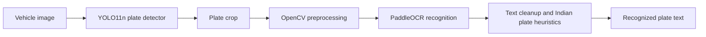
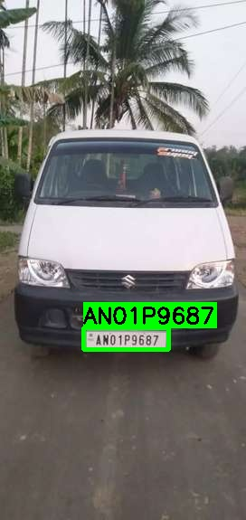

# Indian ANPR: License Plate Detection and Recognition

An experimental, two-stage Automatic Number Plate Recognition (ANPR) pipeline for Indian vehicle images. It combines a fine-tuned YOLO11n plate detector with PaddleOCR, then applies image-cropping and text-normalization heuristics to improve recognition of noisy and two-row plates.

> **Scope:** This repository is a research and engineering case study, not a production-ready or legally authoritative vehicle identification system. Results depend on the dataset, hardware, and OCR/PyTorch/PaddlePaddle versions.

## How it works



The detector and recognizer are deliberately separate. YOLO performs plate localization; PaddleOCR reads the cropped plate. The evaluation pipeline runs YOLO on the GPU and PaddleOCR on the CPU (`use_gpu=False`).

## Example detection

Example output from the pipeline: the detected plate is highlighted and the OCR text is shown above the vehicle's plate.



*Example inference result for `AN01P9687`.*

## Results

### Plate detector

The final epoch in the checked-in training run's `results.csv` reports these **validation** metrics:

| Metric | Result |
| --- | ---: |
| Precision | 99.89% |
| Recall | 100.00% |
| mAP@0.50 | 99.50% |
| mAP@0.50:0.95 | 85.04% |

The run used 50 epochs, 640-pixel images, and batch size 16. Reported detector inference time is approximately **4.2 ms per frame on an NVIDIA RTX 2050**; actual latency varies with hardware and inference settings.

### End-to-end text recognition

The following OCR metrics are **reported from the project's 602-image evaluation**, rather than recomputed by this README:

| Pipeline iteration | Exact-match accuracy | Character error rate |
| --- | ---: | ---: |
| Baseline PaddleOCR | 44.19% | 24.18% |
| Rule-based post-processing | 51.00% | 23.32% |
| CLAHE preprocessing (unsuccessful) | 33.22% | 38.45% |
| Bicubic upsampling and tighter crop | **56.15%** | **12.07%** |

The reported end-to-end latency is approximately **200 ms per image**. The evaluation script currently searches `Dataset_1/State-wise_OLX` for `.jpg` files; reproducing the reported 602-image evaluation requires the same image subset and model used for that experiment.

## Recognition improvements explored

- **Tighter plate crops:** The evaluation path uses 2% horizontal and 5% vertical padding to reduce interference from screws, borders, and HSRP markings.
- **2x bicubic upsampling:** Enlarges small plate crops before OCR.
- **Vertical OCR-line ordering:** Sorts OCR text boxes from top to bottom before joining them, helping with two-row plates.
- **Heuristic text normalization:** Removes non-alphanumeric noise and applies positional character substitutions intended for Indian registration formats, such as `0`/`O`, `1`/`I`, and `8`/`B`.
- **CLAHE experiment:** Reduced accuracy on this dataset by amplifying compression artifacts, shadows, and plate wear; it is not part of the final evaluation path.

The format heuristics are approximations, not a complete implementation of every Indian registration category. They can miscorrect unusual, temporary, diplomatic, or otherwise non-standard plates.

## Repository contents

| File or directory | Purpose |
| --- | --- |
| `main_anpr.py` | Runs detection and OCR on one configured test image and saves an annotated result. |
| `evaluate_pipeline.py` | Evaluates detection plus OCR against XML plate-text annotations. |
| `prepare_yolo_dataset.py` | Converts Pascal VOC XML annotations into YOLO labels and creates train/validation/test splits. |
| `train_yolo.py` | Fine-tunes YOLO11n using the prepared dataset. |
| `Dataset_1/` | Local source images and Pascal VOC XML annotations; not included in Git. |
| `yolo_combined_v1/` | Generated YOLO dataset and split metadata; not included in Git. |
| `runs/` | Training logs, plots, and trained weights; not included in Git. |
| `output_results/` | Annotated inference images; not included in Git. |

Generated datasets, checkpoints, and output images are excluded by `.gitignore`. Supply your own dataset and retain the rights to use and share it.

## Setup

The scripts use paths relative to their own location, so the repository can be cloned to a directory of your choice. Examples below use Windows PowerShell.

1. Install **Python 3.10 or 3.11** and create a virtual environment:

   ```powershell
   py -3.10 -m venv .venv
   .\.venv\Scripts\Activate.ps1
   python -m pip install --upgrade pip
   ```

2. Install the core packages:

   ```powershell
   python -m pip install ultralytics opencv-python paddleocr
   python -m pip install paddlepaddle
   ```

   PaddleOCR is configured for CPU inference in this project. For YOLO GPU training/inference, install a CUDA-enabled PyTorch build compatible with your NVIDIA driver by following the [official PyTorch installation selector](https://pytorch.org/get-started/locally/). Confirm CUDA is available before training:

   ```powershell
   python -c "import torch; print(torch.cuda.is_available())"
   ```

   PaddlePaddle wheels vary by operating system and Python version; if its installation fails, follow the [official PaddlePaddle installation guide](https://www.paddlepaddle.org.cn/install/quick).

3. Add the source dataset locally. The annotation converter expects image and Pascal VOC `.xml` annotation files together under `Dataset_1/`. For example:

   ```text
   Dataset_1/
   └── State-wise_OLX/
       └── AN/
           ├── AN1.jpg
           └── AN1.xml
   ```

   The inference example uses `Dataset_1/State-wise_OLX/AN/AN1.jpg`. Update `TEST_IMAGE` in `main_anpr.py` if your example image has a different path.

## Run the pipeline

Run commands from the repository root:

```powershell
# Convert XML annotations, create YOLO labels, and split the dataset.
python prepare_yolo_dataset.py

# Train YOLO11n; the Ultralytics model name downloads the pretrained
# yolo11n.pt checkpoint if it is not already available.
python train_yolo.py

# Detect/read the configured example image and save an annotated result.
python main_anpr.py

# Evaluate OCR against the XML annotations in Dataset_1/State-wise_OLX.
python evaluate_pipeline.py
```

Training currently selects `device=0` and `batch=16`. If CUDA is unavailable or GPU memory is insufficient, edit those training options in `train_yolo.py` before running it. The trained detector is written under `runs/plate_detection/yolo11n_plate_run/weights/`; inference scripts expect `best.pt` there.

## Dataset split and evaluation notes

The dataset preparation script shuffles eligible annotated records with seed `42` and creates an approximately 70/15/15 train/validation/test split. The local generated split contains 725 training, 155 validation, and 156 test images. Regenerating the dataset replaces files under the ignored `yolo_combined_v1/` directory.

`evaluate_pipeline.py` reads ground-truth plate text from Pascal VOC XML and scans the source `State-wise_OLX` directory; it does not currently restrict evaluation to the generated YOLO test split. Treat its results as comparable only when using the same image subset and evaluation setup.

## Development notes

- A custom CRNN-BiLSTM recognition model was explored, but limited training data led to overfitting and weak generalization. The project pivoted to YOLO localization plus PaddleOCR recognition.
- The project reports a native-framework compatibility issue when combining GPU-enabled PyTorch and PaddleOCR in one process. Running PaddleOCR with `use_gpu=False` was the selected workaround; compatibility can still depend on the installed framework builds.
- The next proposed step is fine-tuning a PaddleOCR recognition model on cropped Indian plate images with appropriate train/validation separation.

## License and data

No dataset or model license is defined here. Check the source and usage terms for any images, pretrained weights, and dependencies before redistribution or commercial use. License plates can contain identifying information; handle collected images and predictions in accordance with applicable privacy and data-protection requirements.
